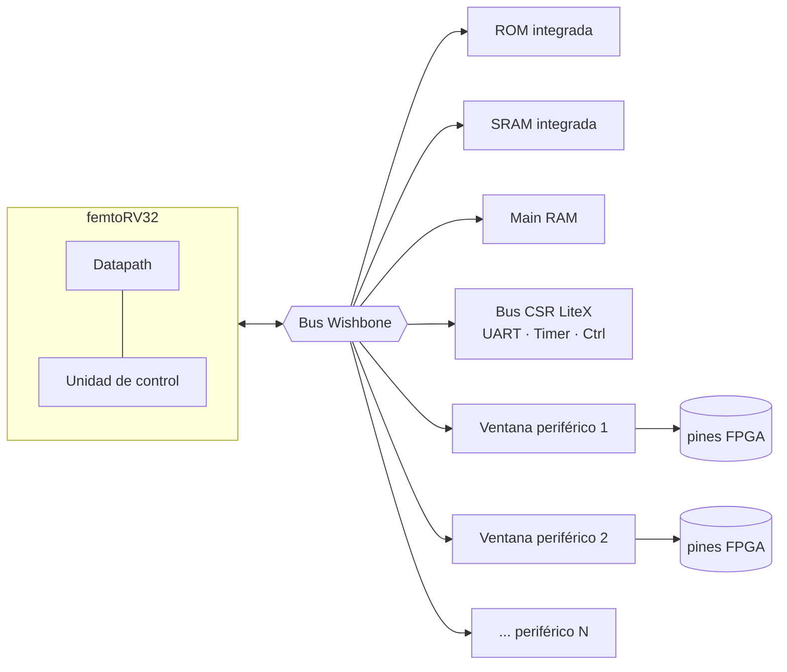
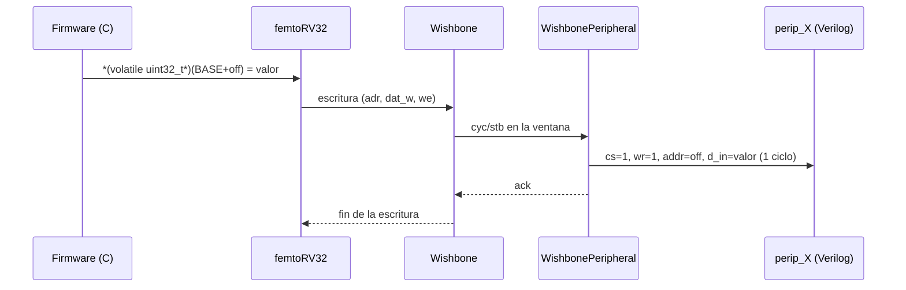
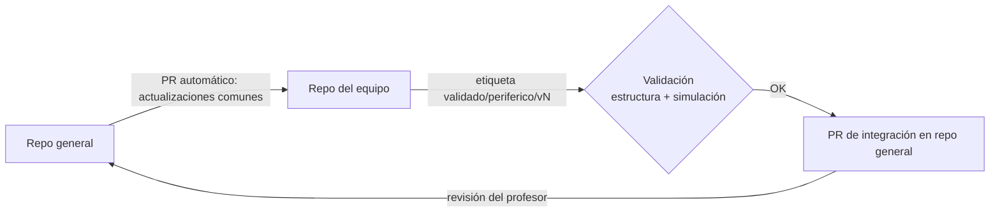

# Diagramas generales del sistema

> Diagramas del SoC completo. Cada periférico tiene los suyos en `cores/<periferico>/diagramas/`.
> Mantenga estos diagramas coherentes con `interfaces/memory_map.yml`.

## Diagrama de bloques del SoC

Imagen equivalente en `diagrama_soc_digital2.svg`.

## Flujo de una operación de firmware sobre un periférico

## Flujo de desarrollo (repo general ⇄ equipos)

